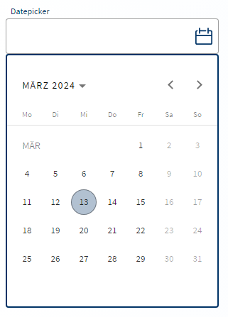
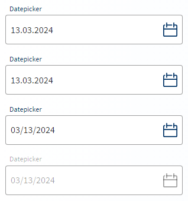
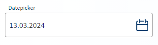
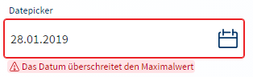

# LUX-Datepicker



- [LUX-Datepicker](#lux-datepicker)
  - [Overview / API](#overview--api)
    - [Allgemein](#allgemein)
    - [@Input](#input)
    - [@Output](#output)
  - [Beispiele](#beispiele)
    - [1. Signal Forms](#1-signal-forms)
    - [2. Ohne Formular](#2-ohne-formular)
    - [3. Mit Formular](#3-mit-formular)
    - [4. Min- und Max-Date](#4-min--und-max-date)
    - [5. Eigener Filter](#5-eigener-filter)
    - [6. Datum und Uhrzeit](#6-datum-und-uhrzeit)
  - [Zusatzinformationen](#zusatzinformationen)

## Overview / API

### Allgemein

| Name     | Beschreibung                      |
| -------- | --------------------------------- |
| selector | lux-datepicker, lux-datepicker-ac |

### @Input

| Name                   | Typ                                              | Beschreibung                                                                                                                                                                                                                                                                                                                                            |
| ---------------------- | ------------------------------------------------ | ------------------------------------------------------------------------------------------------------------------------------------------------------------------------------------------------------------------------------------------------------------------------------------------------------------------------------------------------------- |
| formField              | FieldTree\<T\>                                   | Bindet das Element an ein Feld eines [Angular Signal Forms](https://angular.dev/guide/forms/signals/overview) (Direktive `FormField` aus `@angular/forms/signals`). Pflichtfeld, Deaktivierung und Fehler werden aus dem Schema übernommen. Format, Grenzen und Filter prüft der Validator `luxDateValue()` (siehe [1. Signal Forms](#1-signal-forms)). |
| value                  | string \| null ("yyyy-MM-dd", z.B. '2021-09-21') | Der Wert des Elements, ein Tag ohne Zeitzone. Two-Way-Binding über `[(value)]`. Innerhalb eines Signal Forms wird stattdessen `[formField]` verwendet. Siehe [Zusatzinformationen](#zusatzinformationen).                                                                                                                                               |
| luxValue               | string \| null ("yyyy-MM-dd", z.B. '2021-09-21') | **Veraltet**, stattdessen `[(value)]` bzw. `[formField]` verwenden. Beinhaltet den aktuellen Wert des Datepickers.                                                                                                                                                                                                                                      |
| luxStartView           | 'month' \| 'year' \| 'multi-year'                | Bestimmt die Startansicht des Datepickers (Monats-, Jahres- oder Mehrjahresansicht). Mögliche Werte: 'month', 'year', 'multi-year'. Default: 'month'.                                                                                                                                                                                                   |
| luxTouchUi             | boolean                                          | Aktiviert bzw. Deaktiviert die vergrößerte Touch-Ansicht für den Datepicker (leichtere Eingabe für Mobilgeräte). Default: false.                                                                                                                                                                                                                        |
| luxOpened              | boolean                                          | Bestimmt, ob das Auswahlfenster ausgeklappt oder eingeklappt ist. Default: false.                                                                                                                                                                                                                                                                       |
| luxStartDate           | string ("yyyy-MM-dd", z.B. '2000-01-01')         | Bestimmt das Startdatum für den Datepicker.                                                                                                                                                                                                                                                                                                             |
| luxShowToggle          | boolean                                          | Bestimmt, ob der Toggle-Button sichtbar ist oder nicht. Default: true.                                                                                                                                                                                                                                                                                  |
| luxTagId               | string                                           | [LUX-Tag-Id](luxTagId-v22#direkte-konfiguration) für die automatischen Tests.                                                                                                                                                                                                                                                                           |
| luxCustomFilter        | LuxDateFilterFn                                  | Der optionale eigene Filter für den Datepicker: `(date: string) => boolean`. Der Tag kommt als "yyyy-MM-dd", den Wochentag liefert `LuxUtil.getDayOfWeek()` (siehe [5. Eigener Filter](#5-eigener-filter)).                                                                                                                                             |
| luxMaxDate             | string ("yyyy-MM-dd", z.B. '2099-12-31')         | Das maximal zulässige Datum für den Datepicker.                                                                                                                                                                                                                                                                                                         |
| luxMinDate             | string ("yyyy-MM-dd", z.B. '2000-01-01')         | Das minimal zulässige Datum für den Datepicker.                                                                                                                                                                                                                                                                                                         |
| luxReferenceControl    | LuxReferenceControl                              | Verknüpft den Datepicker mit einem [LUX-Timepicker](lux‐timepicker-v22), damit sich beide einen Wert "yyyy-MM-ddTHH:mm" teilen (siehe [6. Datum und Uhrzeit](#6-datum-und-uhrzeit)).                                                                                                                                                                    |
| luxPlaceholder         | string                                           | Text der als Platzhalter, solange kein anderer Wert eingetragen ist, dargestellt wird.                                                                                                                                                                                                                                                                  |
| luxAutocomplete        | string                                           | Steuert, ob der Browser den Inhalt cachen darf. Default: 'off'.                                                                                                                                                                                                                                                                                         |
| luxRequired            | boolean                                          | Bestimmt, ob die Component ein Pflichtfeld ist oder nicht. Technisch als `model()` umgesetzt; eine Two-Way-Bindung wird nicht benötigt.                                                                                                                                                                                                                 |
| luxControlBinding      | string                                           | **Veraltet**, stattdessen `[formField]` verwenden. Das Controlbinding (z.B. firstname) verbindet das Formularelement mit einem Wert aus dem Modell. (!) Diese Eigenschaft kann nur verwendet werden, wenn das Element innerhalb eines Formulars verwendet wird.                                                                                         |
| luxErrorMessage        | string                                           | Fehlertext, wenn das Formularelement nicht valide ist. Der Fehlertext ersetzt den Hinweistext, wenn es einen gibt. Ersetzt den luxErrorCallback, wenn gesetzt.                                                                                                                                                                                          |
| luxDisabled            | boolean                                          | Bestimmt, ob die Component deaktiviert ist oder nicht. Two-Way-Binding über `[(luxDisabled)]` möglich.                                                                                                                                                                                                                                                  |
| luxReadonly            | boolean                                          | **Veraltet**, stattdessen `[readonly]` bzw. die `readonly()`-Regel im Signal-Forms-Schema verwenden. Bestimmt, ob sich das Feld im reinen Lese-Zustand befindet.                                                                                                                                                                                        |
| luxErrorCallback       | LuxErrorCallbackFnType                           | Callback-Funktion die aufgerufen wird nachdem die Validierung der Component stattgefunden hat. Hier kann dann entsprechend aus dem übergebenen Errors-Objekt ein Fehler ausgelesen und die passende Fehlermeldung zurückgegeben werden. Liefert der Callback `undefined` zurück, wird die Defaultfehlermeldung ausgegeben.                              |
| luxControlValidators   | ValidatorFnType                                  | Validator-Funktion oder ein Array von Validator-Funktionen, die für diese Component hereingereicht werden können. Diese werden nur für nicht-ReactiveForms-Components angewendet und sollen so eine Validierung für "normale" Komponenten ermöglichen.                                                                                                  |
| luxLabel               | string                                           | Property welche ein Label oberhalb der FormComponent (Ausnahme: LuxToggle und LuxCheckbox, diese stellen das Label rechts von der Schaltfläche dar) darstellt. Technisch als `model()` umgesetzt; eine Two-Way-Bindung wird nicht benötigt.                                                                                                             |
| luxHint                | string                                           | Property, welche einen Tipp/Text unterhalb der FormComponent darstellt. Alternativ kann man über das Content-Child `lux-form-hint` komplexere Hinweise (z.B. mit einem Link) darstellen.                                                                                                                                                                |
| luxHintShowOnlyOnFocus | boolean                                          | Gibt an, ob der Hinweis (siehe luxHint) nur angezeigt wird, wenn das Element den Fokus hat.                                                                                                                                                                                                                                                             |
| luxLabelLongFormat     | boolean                                          | Bestimmt, ob das Label mehrzeilig sein kann. Nutzung nur in Spalten empfohlen, da die Höhe des Formcontrols variieren kann. Dadurch kann die Ausrichtung an der Baseline nicht mehr gewährleistet werden.                                                                                                                                               |
| luxNoLabels            | boolean                                          | Gibt an, ob Labels angezeigt werden sollen.                                                                                                                                                                                                                                                                                                             |
| luxNoTopLabel          | boolean                                          | Gibt an, ob das obere Label angezeigt werden soll.                                                                                                                                                                                                                                                                                                      |
| luxNoBottomLabel       | boolean                                          | Gibt an, ob das untere Label (Hinweis oder Fehlermeldung) angezeigt werden soll.                                                                                                                                                                                                                                                                        |
| luxDense               | boolean                                          | Property um die Höhe der Komponente zu verringern. Diese Eigenschaft ist für den Einsatz in großen Formularen gedacht und soll nicht standardmäßig in einer Anwendung genutzt werden.                                                                                                                                                                   |
| luxId                  | string                                           | Id des Formularelements. Ohne Angabe wird eine eindeutige Id generiert.                                                                                                                                                                                                                                                                                 |
| luxAriaLabel           | string                                           | Setzt `aria-label` am Eingabeelement. Nur für Felder ohne sichtbares Label gedacht; ein abweichendes aria-label überschreibt ein sichtbares Label (WCAG 2.5.3).                                                                                                                                                                                         |
| luxAriaLabelledby      | string                                           | Verweist per `aria-labelledby` auf ein externes Label-Element. Hat Vorrang vor luxAriaLabel und luxLabel.                                                                                                                                                                                                                                               |
| luxFormGroup           | FormGroup                                        | **Veraltet**, stattdessen `[formField]` verwenden. FormGroup, in der das luxControlBinding gesucht wird, wenn die Komponente nicht innerhalb von `[formGroup]` steht.                                                                                                                                                                                   |
| luxFormControl         | FormControl                                      | **Veraltet**, stattdessen `[formField]` verwenden. Direkt übergebenes FormControl.                                                                                                                                                                                                                                                                      |

### @Output

| Name              | Typ            | Beschreibung                                                                                                                                                                                                                                                                                       |
| ----------------- | -------------- | -------------------------------------------------------------------------------------------------------------------------------------------------------------------------------------------------------------------------------------------------------------------------------------------------- |
| luxValueChange    | string         | Gehört zur veralteten `luxValue`-API, stattdessen `(valueChange)` verwenden. Output-Event das bei Änderungen am Value-Feld ausgestoßen wird. Ermöglicht das Two-Way-Binding an luxValue.                                                                                                           |
| luxBlur           | FocusEvent     | Event welches beim Fokusverlust des Elements ausgelöst wird und ein Objekt vom Typ FocusEvent weitergibt. Unterschied zu luxFocusOut (LUX-FORM-COMPONENT-BASE) ist der, dass dieses Event nur ausgegeben wird wenn das Element selbst den Fokus verliert und Kindelemente nicht betrachtet werden. |
| luxFocus          | FocusEvent     | Event welches beim Fokussieren des Elements ausgelöst wird und ein Objekt vom Typ FocusEvent weitergibt. Unterschied zu luxFocusIn (LUX-FORM-COMPONENT-BASE) ist der, dass dieses Event nur ausgegeben wird wenn das Element selbst den Fokus erhält und Kindelemente nicht betrachtet werden.     |
| luxFocusIn        | FocusEvent     | Event welches beim Fokussieren des Elements ausgelöst wird und ein Objekt vom Typ FocusEvent weitergibt.                                                                                                                                                                                           |
| luxFocusOut       | FocusEvent     | Event welches beim Fokusverlust des Elements ausgelöst wird und ein Objekt vom Typ FocusEvent weitergibt.                                                                                                                                                                                          |
| luxDisabledChange | boolean        | Event welches beim Disablen des Elements ausgelöst wird.                                                                                                                                                                                                                                           |
| valueChange       | string \| null | Wird ausgelöst, wenn sich der Wert ändert (implizit aus dem `value`-Model, Grundlage von `[(value)]`).                                                                                                                                                                                             |

## Beispiele

### 1. Signal Forms

Ab v22 lässt sich die Komponente über `[formField]` an ein [Angular Signal Form](https://angular.dev/guide/forms/signals/overview) binden. Pflichtfeld, Deaktivierung und Validierung werden im Schema von `form()` festgelegt. Ein dort hinterlegter `message`-Text wird als Fehlermeldung angezeigt (`luxErrorMessage` und `luxErrorCallback` haben Vorrang). Die Direktive `FormField` muss in den `imports` der Komponente stehen.

Die Komponente zeigt einen Wert im falschen Format oder außerhalb der Grenzen als Fehler an, kann das Feld im Signal Form aber nicht selbst ungültig machen. Dafür gibt es den Validator `luxDateValue()` mit denselben Grenzen und demselben Filter wie die Inputs. Eine ungültige Texteingabe meldet die Komponente selbst an das Feld.

Ts

```typescript
import { FormField, form, required, validate } from '@angular/forms/signals';
import { LuxUtil, luxDateValue } from '@ihk-gfi/lux-components';

// Der Wert ist ein Tag ohne Zeitzone, z.B. '2021-09-21'.
readonly model = signal<{ birthday: string | null }>({ birthday: null });
readonly personForm = form(this.model, (path) => {
  required(path.birthday, { message: 'Bitte geben Sie Ihr Geburtsdatum ein.' });
  validate(path.birthday, luxDateValue({ max: () => LuxUtil.todayAsLocalDate() }));
});
```

Html

```html
<lux-datepicker luxLabel="Geburtsdatum" [formField]="personForm.birthday" />
```

### 2. Ohne Formular



Ts

```typescript
// Heutiger Tag aus Sicht des Nutzers (LuxUtil aus '@ihk-gfi/lux-components')
readonly value = signal<string | null>(LuxUtil.todayAsLocalDate());
```

Html

```html
<lux-datepicker
  luxLabel="Datepicker"
  [luxTouchUi]="true"
  [(value)]="value"
/>
<lux-datepicker
  luxLabel="Datepicker"
  [luxTouchUi]="false"
  [(value)]="value"
/>
<lux-datepicker
  luxLabel="Datepicker"
  [luxDisabled]="true"
  luxPlaceholder="Disabled"
  [(value)]="value"
/>
```

### 3. Mit Formular

> **Veraltet:** Die Reactive-Forms-Variante (`luxControlBinding`) in diesem Beispiel funktioniert in v22 weiterhin, entfällt aber mit der nächsten Major-Version. Für neue Formulare bitte Signal Forms verwenden (siehe [1. Signal Forms](#1-signal-forms)).



Ts

```typescript
readonly form = new FormGroup({
  // Heutiger Tag aus Sicht des Nutzers (LuxUtil aus '@ihk-gfi/lux-components')
  datepicker: new FormControl<string | null>(LuxUtil.todayAsLocalDate())
});
```

Html

```html
<div [formGroup]="form">
  <lux-datepicker luxLabel="Datepicker" luxControlBinding="datepicker" />
</div>
```

### 4. Min- und Max-Date



Ts

```typescript
readonly value = signal<string | null>(null);
```

Html

```html
<lux-datepicker
  luxLabel="Datepicker"
  luxMinDate="2000-02-02"
  luxMaxDate="2002-02-02"
  [(value)]="value"
/>
```

### 5. Eigener Filter


Der Filter erhält jeden Tag als "yyyy-MM-dd" (z.B. `2029-05-26`). Den Wochentag liefert `LuxUtil.getDayOfWeek()` (0 = Sonntag bis 6 = Samstag).

Ts

```typescript
// Samstag und Sonntag in der Datumsauswahl deaktivieren
readonly myFilter = (date: string): boolean => ![0, 6].includes(LuxUtil.getDayOfWeek(date)!);
```

Html

```html
<lux-datepicker
  luxLabel="Datepicker"
  [luxCustomFilter]="myFilter"
/>
```

### 6. Datum und Uhrzeit

Für Datum und Uhrzeit gibt es zwei Wege.

**Getrennte Werte:** Datepicker und [LUX-Timepicker](lux‐timepicker-v22) haben jeweils ein eigenes Feld (`"2029-05-26"` und `"14:30"`). Zusammengeführt wird bei Bedarf mit `LuxUtil.combineDateTime()`. Dieser Weg ist nötig, wenn erkennbar sein muss, ob eine Uhrzeit gewählt wurde.

**Gemeinsamer Wert:** Beide Komponenten teilen sich ein Feld mit `"2029-05-26T14:30"` und werden über `luxReferenceControl` verknüpft. Der Datepicker ändert nur das Datum, der Timepicker nur die Uhrzeit. Die Regeln dazu stehen beim [LUX-Timepicker](lux‐timepicker-v22#5-datum-und-uhrzeit). Wie ein Zeitpunkt aus dem Backend (z.B. Java `Instant`) umgerechnet wird, steht ebenfalls dort, siehe [7. Zeitpunkte aus dem Backend](lux‐timepicker-v22#7-zeitpunkte-aus-dem-backend).

Html

```html
<lux-datepicker luxLabel="Datum" [formField]="terminForm.termin" [luxReferenceControl]="timepicker" #datepicker />
<lux-timepicker luxLabel="Uhrzeit" [formField]="terminForm.termin" [luxReferenceControl]="datepicker" #timepicker />
```

## Zusatzinformationen

Der Datepicker arbeitet mit einem Tag ohne Zeitzone (wie Java `LocalDate` oder .NET `DateOnly`). Der Wert ist immer `"yyyy-MM-dd"`, z.B. `2029-05-26`. Damit zeigt der Datepicker in jeder Zeitzone denselben Tag an, auch an den Tagen der Zeitumstellung.

- Beim Einlesen wird zusätzlich Mitternacht ohne Zeitzone angenommen (`2029-05-26T00:00` bzw. `2029-05-26T00:00:00`, z.B. Java `LocalDateTime` für ein reines Datum). Ein solcher Wert wird nicht umgeschrieben. Erst eine Änderung durch den Nutzer schreibt `"yyyy-MM-dd"`.
- Im Backend gehört zum Datepicker deshalb ein reines Datum (Java `LocalDate`, .NET `DateOnly`). Ein Feld vom Typ `LocalDateTime` würde nach einer Änderung mit `"yyyy-MM-dd"` beschrieben, das ist kein `LocalDateTime`. Datum und Uhrzeit in einem Feld bearbeiten Datepicker und Timepicker gemeinsam (siehe [LUX-Timepicker](lux‐timepicker-v22#zusatzinformationen)).
- Alle anderen Werte werden mit einem Validierungsfehler (`matDatepickerParse`) abgelehnt, roh im Feld angezeigt und bleiben unverändert im Model, auch das Format bis Version 21 (`2029-05-26T00:00:00.000Z`), `Date`-Objekte und Werte mit Offset. Im Dev-Modus erscheint zusätzlich eine Warnung in der Konsole. Für Werte im Format bis Version 21 gibt es `LuxUtil.fromV21Date()` (siehe [Update-Guide v22](update-guide-v22#datums--und-zeitwerte-ohne-zeitzone)).
- Die Texteingabe wird in der Reihenfolge der aktiven Sprache gelesen (de: `dd.MM.yyyy`, en-US: `MM/dd/yyyy`, en-GB: `dd/MM/yyyy`). Tag und Monat dürfen ein- oder zweistellig sein, Trenner sind optional (ohne Trenner genau 8 Ziffern, z.B. `26052029`). Das Jahr muss vierstellig sein.
- Eine ungültige Eingabe bleibt mit ihrem Fehler im Feld stehen, auch wenn sich `luxMinDate`, `luxMaxDate`, `luxCustomFilter`, `luxRequired` oder `luxControlValidators` ändern. Der Wert ist dabei `null`, beim gemeinsamen Wert bleibt er unverändert. Die Eingabe verschwindet durch eine Korrektur, einen neu gesetzten Wert, einen Sprachwechsel oder das Zurücksetzen des Formulars (`form.reset()` bzw. `form().reset()`). Bei `[(value)]` gilt das nur für einen geänderten Wert.
- `luxMinDate`, `luxMaxDate` und `luxStartDate` werden ebenfalls als `"yyyy-MM-dd"` angegeben. In einem anderen Format werden sie ignoriert, eine Grenze gilt dann nicht. Das fällt nur im Dev-Modus über eine Warnung in der Konsole auf. `luxDateValue()` und `luxDateTimeValue()` ignorieren solche Grenzen ebenfalls, dort ganz ohne Warnung.
- Hilfsfunktionen für Werte ohne Zeitzone (z.B. `LuxUtil.todayAsLocalDate()`, `LuxUtil.addDays()`) stehen auf der Seite [Util](util-v22#datums--und-zeitwerte-ohne-zeitzone).
