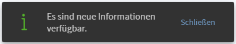
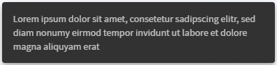

# LUX-Snackbar



- [LUX-Snackbar](#lux-snackbar)
  - [Overview / API](#overview--api)
    - [Allgemein](#allgemein)
    - [Einrichtung](#einrichtung)
    - [Mehrere Nachrichten](#mehrere-nachrichten)
  - [Components](#components)
    - [LuxSnackbarComponent](#luxsnackbarcomponent)
  - [Classes / Interfaces](#classes--interfaces)
    - [LuxSnackbarConfig](#luxsnackbarconfig)
    - [LuxSnackbarType](#luxsnackbartype)
    - [LuxSnackbarLimits](#luxsnackbarlimits)
    - [LuxSnackbarRef](#luxsnackbarref)
    - [LuxSnackbarDismiss](#luxsnackbardismiss)
    - [LUX\_SNACKBAR\_DATA](#lux_snackbar_data)
  - [Beispiele](#beispiele)
    - [1. Snackbar mit Text](#1-snackbar-mit-text)
    - [2. Snackbar mit Icon und Action](#2-snackbar-mit-icon-und-action)
    - [3. Mehrere Nachrichten](#3-mehrere-nachrichten)
    - [4. Eigene Komponente](#4-eigene-komponente)
  - [Zusatzinformationen](#zusatzinformationen)

## Overview / API

### Allgemein

| Name     | Beschreibung                                   |
| -------- | ---------------------------------------------- |
| name     | LuxSnackbarService                             |
| import   | @ihk-gfi/lux-components/lux-snackbar           |
| provider | provideLuxSnackbar(limits?: LuxSnackbarLimits) |

| Funktion                                                                                                                  | Beschreibung                                                                                                                                                                          |
| ------------------------------------------------------------------------------------------------------------------------- | ------------------------------------------------------------------------------------------------------------------------------------------------------------------------------------- |
| open(duration: number, config?: LuxSnackbarConfig): LuxSnackbarRef                                                        | Öffnet eine Nachricht anhand der übergebenen Konfiguration. Ermöglicht eine genaue Konfiguration der Nachricht.                                                                       |
| openText(message: string, duration: number, actionName?: string): LuxSnackbarRef                                          | Öffnet eine Nachricht mit einem Text und optional einer Action.                                                                                                                       |
| openComponent(component: ComponentType\<unknown>, duration: number = 0, data?: D, type?: LuxSnackbarType): LuxSnackbarRef | Öffnet eine Nachricht, in der die übergebene Komponente angezeigt wird. Die Komponente erhält `data` über `inject(LUX_SNACKBAR_DATA)` und die Referenz über `inject(LuxSnackbarRef)`. |
| setLimits(limits: LuxSnackbarLimits): void                                                                                | Legt fest, wie viele Nachrichten gleichzeitig sichtbar sind (gesamt oder je Typ).                                                                                                     |
| dismiss(): void                                                                                                           | Schließt alle Nachrichten.                                                                                                                                                            |

`duration` ist die Anzeigedauer in Millisekunden (z.B. 2000 = 2 Sekunden). Mit dem Wert 0 bleibt die Nachricht stehen, bis sie über ihre Action, den Ok-Button, `LuxSnackbarRef.dismiss()` oder `dismiss()` geschlossen wird. Nachrichten ohne Action erhalten automatisch einen Ok-Button zum Schließen (siehe `showCloseButton`), da sie sich sonst nicht schließen ließen, solange ihre Anzeigedauer pausiert.

### Einrichtung

Die Snackbar liegt in einem eigenen Entry Point. Der Provider `provideLuxSnackbar()` wird in der `app.config.ts` eingetragen. Er legt die Start-Limits fest und stellt die Snackbar auch den LUX-Komponenten zur Verfügung, die selbst Meldungen anzeigen (z.B. [lux-stepper-large](lux‐stepper‐large-v22)).

```typescript
import { provideLuxSnackbar } from '@ihk-gfi/lux-components/lux-snackbar';

export const appConfig: ApplicationConfig = {
  providers: [
    provideLuxComponentsConfig(myConfiguration),
    provideLuxSnackbar({ maxVisible: 3 })
  ]
};
```

Ohne `provideLuxSnackbar()` kann der `LuxSnackbarService` trotzdem verwendet werden (Limit 1). Der lux-stepper-large sagt seine Meldung dann aber nur per Screenreader an.

### Mehrere Nachrichten

Neue Nachrichten ersetzen keine vorhandenen, sondern werden oben eingefügt. Wie viele Nachrichten gleichzeitig sichtbar sind, bestimmen die [Limits](#luxsnackbarlimits) (Default: 1).
Liegen mehr Nachrichten vor, als angezeigt werden dürfen, erscheint unter den sichtbaren Nachrichten der Hinweis "und X weitere Nachrichten". Ein Klick darauf zeigt alle Nachrichten an; die Liste ist scrollbar, wenn sie höher als der verfügbare Platz wird. Über "Weniger anzeigen" wird sie wieder zugeklappt.

Alle Nachrichten sind gleich breit (Theme-Variable `--lux-theme-snackbar-width`, Default: 400px); längere Texte brechen um. Auf kleinen Bildschirmen nutzen die Nachrichten die volle Breite. Die Ecken werden über `--lux-theme-snackbar-border-radius` gesteuert.

Die Anzeigedauer einer Nachricht läuft erst, wenn sie sichtbar ist. Solange die Maus über der Snackbar steht, der Fokus in ihr liegt oder die Liste aufgeklappt ist, pausieren alle Nachrichten und laufen danach mit ihrer Restzeit weiter.

## Components

### LuxSnackbarComponent

Diese Component wird vom LuxSnackbarService dazu genutzt, eine Text-Nachricht (Icon, Text, Action) darzustellen (über die Funktionen open() und openText()).

| Name     | Beschreibung |
| -------- | ------------ |
| selector | lux-snackbar |

## Classes / Interfaces

### LuxSnackbarConfig

Diese Klasse ermöglicht die Konfiguration der anzuzeigenden Nachricht. Alle Properties sind optional.

| Name             | Typ              | Beschreibung                                                                                                                                                                                                                                                                    |
| ---------------- | ---------------- | ------------------------------------------------------------------------------------------------------------------------------------------------------------------------------------------------------------------------------------------------------------------------------- |
| type?            | LuxSnackbarType  | Der Typ der Nachricht (`info`, `warning`, `error`, `success`). Er bestimmt Icon und Icon-Farbe, falls `iconName` bzw. `iconColor` nicht gesetzt sind, und kann eigene [Limits](#luxsnackbarlimits) haben. Fehler (`error`) werden dem Screenreader sofort (assertive) angesagt. |
| iconName?        | string           | Bestimmt das Icon, welches in der Nachricht angezeigt werden soll. Default: '' (bzw. das Icon des Typs).                                                                                                                                                                        |
| iconSize?        | string           | Setzt die (relative) Größe des Icons, z.B. '1x' bis '5x'. Default: '3x'.                                                                                                                                                                                                        |
| iconColor?       | LuxSnackbarColor | Bestimmt die Icon-Farbe. Mögliche Werte (Typ `LuxSnackbarColor`): `white`, `red`, `blue`, `green`, `orange`, `yellow`. Der Wert wird als CSS-Klasse umgesetzt, beliebige CSS-Farbwerte sind nicht möglich.                                                                      |
| text?            | string           | Diese Property legt den Text der Nachricht fest.                                                                                                                                                                                                                                |
| textColor?       | LuxSnackbarColor | Bestimmt die Text-Farbe. Mögliche Werte (Typ `LuxSnackbarColor`): `white`, `red`, `blue`, `green`, `orange`, `yellow`. Der Wert wird als CSS-Klasse umgesetzt, beliebige CSS-Farbwerte sind nicht möglich.                                                                      |
| action?          | string           | Über diese Eigenschaft kann der Text einer Action gesetzt werden.                                                                                                                                                                                                               |
| actionColor?     | LuxSnackbarColor | Bestimmt die Action-Farbe. Mögliche Werte (Typ `LuxSnackbarColor`): `white`, `red`, `blue`, `green`, `orange`, `yellow`. Der Wert wird als CSS-Klasse umgesetzt, beliebige CSS-Farbwerte sind nicht möglich.                                                                    |
| showCloseButton? | boolean          | Zeigt einen Ok-Button zum Schließen an. Ohne Angabe erscheint er automatisch bei Nachrichten ohne Action. Mit `true` bzw. `false` wird er immer bzw. nie angezeigt.                                                                                                             |

### LuxSnackbarType

| Wert    | Standard-Icon                          | Standard-Farbe |
| ------- | -------------------------------------- | -------------- |
| info    | lux-interface-alert-information-circle | blue           |
| warning | lux-interface-alert-warning-triangle   | orange         |
| error   | lux-interface-alert-warning-diamond    | red            |
| success | lux-interface-validation-check-circle  | green          |

Der Typ wird aus `@ihk-gfi/lux-components` importiert.

### LuxSnackbarLimits

Legt fest, wie viele Nachrichten gleichzeitig sichtbar sind. Werte kleiner als 1 werden als 1 behandelt.

| Name               | Typ                                        | Beschreibung                                                                                                                                                                |
| ------------------ | ------------------------------------------ | --------------------------------------------------------------------------------------------------------------------------------------------------------------------------- |
| maxVisible?        | number                                     | Ohne `maxVisiblePerType`: Anzahl der insgesamt sichtbaren Nachrichten. Mit `maxVisiblePerType`: Limit für Typen ohne eigenen Wert und für Nachrichten ohne Typ. Default: 1. |
| maxVisiblePerType? | Partial\<Record\<LuxSnackbarType, number>> | Limit je Typ, z.B. `{ info: 2, error: 3, warning: 1 }`. Ist dieser Wert gesetzt, gilt für jeden Typ sein eigenes Limit und es gibt kein Gesamtlimit.                        |

### LuxSnackbarRef

Referenz auf eine einzelne Nachricht. Wird von den open-Funktionen des LuxSnackbarService geliefert.

| Funktion                                          | Beschreibung                                                                |
| ------------------------------------------------- | --------------------------------------------------------------------------- |
| onAction(): Observable\<void>                     | Benachrichtigt, wenn die Action der Nachricht geklickt wurde.               |
| afterDismissed(): Observable\<LuxSnackbarDismiss> | Benachrichtigt, sobald die Nachricht geschlossen wurde.                     |
| dismiss(): void                                   | Schließt die Nachricht.                                                     |
| dismissWithAction(): void                         | Meldet die Action und schließt die Nachricht (z.B. für eigene Komponenten). |

Beide Observables enden, sobald die Nachricht geschlossen wurde. Ein Abmelden ist deshalb nicht nötig.

### LuxSnackbarDismiss

| Name              | Typ     | Beschreibung                                                 |
| ----------------- | ------- | ------------------------------------------------------------ |
| dismissedByAction | boolean | true, wenn die Nachricht über ihre Action geschlossen wurde. |

### LUX_SNACKBAR_DATA

Injection-Token, über das eine mit `openComponent()` geöffnete Komponente ihre Daten erhält: `inject(LUX_SNACKBAR_DATA)`.

## Beispiele

### 1. Snackbar mit Text



Ts

```typescript
private readonly snackbar = inject(LuxSnackbarService);

openSnackbar() {
  this.snackbar.openText(
    'Lorem ipsum dolor sit amet, consetetur sadipscing elitr, ' +
      'sed diam nonumy eirmod tempor invidunt ut labore et dolore magna aliquyam erat',
    6000
  );
}
```

Html

```html
<lux-button luxLabel="Snackbar öffnen" (luxClicked)="openSnackbar()" />
```

### 2. Snackbar mit Icon und Action


Ts

```typescript
private readonly snackbar = inject(LuxSnackbarService);

openSnackbar() {
  const ref = this.snackbar.open(2000, {
    text: 'Es sind neue Informationen verfügbar.',
    textColor: 'white',
    iconName: 'lux-info',
    iconSize: '2x',
    iconColor: 'green',
    action: 'Schließen',
    actionColor: 'blue'
  });

  ref.onAction().subscribe(() => console.log('Action geklickt'));
  ref.afterDismissed().subscribe((dismiss) => console.log('Geschlossen, per Action:', dismiss.dismissedByAction));
}
```

Html

```html
<lux-button luxLabel="Snackbar öffnen" (luxClicked)="openSnackbar()" />
```

### 3. Mehrere Nachrichten

app.config.ts

```typescript
provideLuxSnackbar({ maxVisible: 1, maxVisiblePerType: { error: 3, info: 2 } });
```

Ts

```typescript
private readonly snackbar = inject(LuxSnackbarService);

saveAll() {
  this.snackbar.open(5000, { type: 'success', text: 'Der Antrag wurde gespeichert.' });
  this.snackbar.open(0, { type: 'error', text: 'Die Datei konnte nicht hochgeladen werden.', action: 'Ok' });
  this.snackbar.open(0, { type: 'error', text: 'Der Server ist nicht erreichbar.', action: 'Ok' });
}
```

Alle drei Nachrichten sind sichtbar: Für `error` gilt das Limit 3, für `success` das Limit aus `maxVisible`.

### 4. Eigene Komponente

Ts

```typescript
@Component({
  selector: 'app-upload-snackbar',
  template: `
    <span>{{ data.fileName }} wurde hochgeladen.</span>
    <lux-button luxLabel="Anzeigen" (luxClicked)="ref.dismissWithAction()" />
  `
})
export class UploadSnackbarComponent {
  readonly data = inject<{ fileName: string }>(LUX_SNACKBAR_DATA);
  readonly ref = inject(LuxSnackbarRef);
}

// Aufruf
this.snackbar.openComponent(UploadSnackbarComponent, 5000, { fileName: 'antrag.pdf' }, 'success');
```

## Zusatzinformationen

Die Snackbar ermöglicht es, dem Benutzer wichtige Nachrichten anzuzeigen. Diese Nachrichten legen sich über den eigentlichen Inhalt der Seite (siehe Beispiele oben).

Bitte die Snackbar nur sparsam einsetzen, z.B. um dem Benutzer eine Bestätigung (z.B. Vielen Dank! Ihr Antrag wurde erfolgreich übermittelt) anzuzeigen. Eine Nachricht sollte sich entweder nach einer gewissen Zeit selbst ausblenden oder eine Schaltfläche beinhalten, welche die Nachricht schließt, wenn diese geklickt wurde.

Nachrichten werden dem Screenreader angesagt (Typ `error` sofort, alle anderen höflich). Bei eigenen Komponenten wird der angezeigte Text der Komponente angesagt; Inhalte mit `aria-hidden="true"` werden dabei übersprungen.
