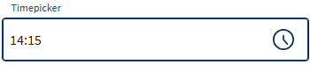
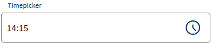
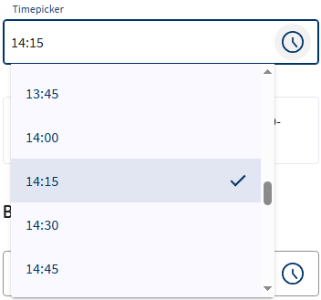
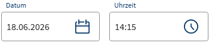

# LUX-Timepicker

- [LUX-Timepicker](#lux-timepicker)
  - [Overview / API](#overview--api)
    - [Allgemein](#allgemein)
    - [@Input](#input)
    - [@Output](#output)
  - [Beispiele](#beispiele)
    - [1. Signal Forms](#1-signal-forms)
    - [2. Ohne Formular](#2-ohne-formular)
    - [3. Mit Formular](#3-mit-formular)
    - [4. Min- und Max-Time](#4-min--und-max-time)
    - [5. Datum und Uhrzeit](#5-datum-und-uhrzeit)
    - [6. Grenzen aus Datum und Uhrzeit](#6-grenzen-aus-datum-und-uhrzeit)
    - [7. Zeitpunkte aus dem Backend](#7-zeitpunkte-aus-dem-backend)
  - [Zusatzinformationen](#zusatzinformationen)

## Overview / API

### Allgemein

| Name     | Beschreibung   |
| -------- | -------------- |
| selector | lux-timepicker |

### @Input

| Name                   | Typ                                    | Beschreibung                                                                                                                                                                                                                                                                                                                                    |
| ---------------------- | -------------------------------------- | ----------------------------------------------------------------------------------------------------------------------------------------------------------------------------------------------------------------------------------------------------------------------------------------------------------------------------------------------- |
| formField              | FieldTree\<T\>                         | Bindet das Element an ein Feld eines [Angular Signal Forms](https://angular.dev/guide/forms/signals/overview) (Direktive `FormField` aus `@angular/forms/signals`). Pflichtfeld, Deaktivierung und Fehler werden aus dem Schema übernommen. Format und Grenzen prüft der Validator `luxTimeValue()` (siehe [1. Signal Forms](#1-signal-forms)). |
| value                  | string \| null ("HH:mm", z.B. '14:15') | Der Wert des Elements, eine Uhrzeit ohne Zeitzone. Two-Way-Binding über `[(value)]`. Innerhalb eines Signal Forms wird stattdessen `[formField]` verwendet. Mit `luxReferenceControl` ist der Wert "yyyy-MM-ddTHH:mm".                                                                                                                          |
| luxValue               | string \| null ("HH:mm", z.B. '14:15') | **Veraltet**, stattdessen `[(value)]` bzw. `[formField]` verwenden. Beinhaltet den aktuellen Wert des Timepickers.                                                                                                                                                                                                                              |
| luxOpened              | boolean                                | Bestimmt, ob das Auswahlfenster ausgeklappt oder eingeklappt ist. Default: false.                                                                                                                                                                                                                                                               |
| luxShowToggle          | boolean                                | Bestimmt, ob der Toggle-Button sichtbar ist oder nicht. Default: true.                                                                                                                                                                                                                                                                          |
| luxInterval            | string \| number \| null               | Intervall für die Zeitauswahl in ganzen Minuten, z.B. `15m`, `30m` oder `1h`. Ein Wert mit Sekundenanteil wird ignoriert (Warnung im Dev-Modus). Default: '30m'.                                                                                                                                                                                |
| luxMinTime             | string ("HH:mm", z.B. '08:00')         | Minimale zulässige Zeit. Default: null.                                                                                                                                                                                                                                                                                                         |
| luxMaxTime             | string ("HH:mm", z.B. '18:00')         | Maximale zulässige Zeit. Default: null.                                                                                                                                                                                                                                                                                                         |
| luxDefaultTime         | string ("HH:mm", z.B. '08:00')         | Uhrzeit beim gemeinsamen Wert mit einem Datepicker (siehe [5. Datum und Uhrzeit](#5-datum-und-uhrzeit)). Sie wird beim ersten Datum und beim Leeren der Uhrzeit gesetzt. Default: '00:00'.                                                                                                                                                      |
| luxPlaceholder         | string                                 | Platzhaltertext. Default: ''.                                                                                                                                                                                                                                                                                                                   |
| luxRequired            | boolean                                | Bestimmt, ob die Component ein Pflichtfeld ist oder nicht. Technisch als `model()` umgesetzt; eine Two-Way-Bindung wird nicht benötigt.                                                                                                                                                                                                         |
| luxControlBinding      | string                                 | **Veraltet**, stattdessen `[formField]` verwenden. Bindet das Formularelement an ein Reactive-Form-Control.                                                                                                                                                                                                                                     |
| luxErrorMessage        | string                                 | Feste Fehlermeldung für ungültige Eingaben.                                                                                                                                                                                                                                                                                                     |
| luxDisabled            | boolean                                | Bestimmt, ob die Component deaktiviert ist oder nicht. Two-Way-Binding über `[(luxDisabled)]` möglich.                                                                                                                                                                                                                                          |
| luxReadonly            | boolean                                | **Veraltet**, stattdessen `[readonly]` bzw. die `readonly()`-Regel im Signal-Forms-Schema verwenden. Bestimmt, ob sich das Feld im reinen Lese-Zustand befindet.                                                                                                                                                                                |
| luxLabel               | string                                 | Label oberhalb der Component. Technisch als `model()` umgesetzt; eine Two-Way-Bindung wird nicht benötigt.                                                                                                                                                                                                                                      |
| luxHint                | string                                 | Hinweistext unterhalb der Component.                                                                                                                                                                                                                                                                                                            |
| luxHintShowOnlyOnFocus | boolean                                | Zeigt den Hinweis nur bei Fokus an.                                                                                                                                                                                                                                                                                                             |
| luxNoLabels            | boolean                                | Gibt an, ob Labels angezeigt werden sollen.                                                                                                                                                                                                                                                                                                     |
| luxNoTopLabel          | boolean                                | Gibt an, ob das obere Label angezeigt werden soll.                                                                                                                                                                                                                                                                                              |
| luxNoBottomLabel       | boolean                                | Gibt an, ob das untere Label angezeigt werden soll.                                                                                                                                                                                                                                                                                             |
| luxReferenceControl    | LuxReferenceControl                    | Verknüpft den Timepicker mit einem [LUX-Datepicker](lux‐datepicker-v22), damit sich beide einen Wert "yyyy-MM-ddTHH:mm" teilen (siehe [5. Datum und Uhrzeit](#5-datum-und-uhrzeit)).                                                                                                                                                            |
| luxAutocomplete        | string                                 | Steuert, ob der Browser den Inhalt cachen darf. Default: `off`.                                                                                                                                                                                                                                                                                 |
| luxTagId               | string                                 | [LUX-Tag-Id](luxTagId-v22#direkte-konfiguration) für die automatischen Tests.                                                                                                                                                                                                                                                                   |
| luxControlValidators   | ValidatorFnType                        | Validator-Funktion oder ein Array von Validator-Funktionen für den Einsatz ohne Formular (z.B. mit `[(value)]`).                                                                                                                                                                                                                                |
| luxErrorCallback       | LuxErrorCallbackFnType                 | Callback-Funktion, die nach der Validierung aufgerufen wird und aus dem Errors-Objekt eine Fehlermeldung ermitteln kann. Liefert der Callback `undefined` zurück, wird die Defaultfehlermeldung ausgegeben.                                                                                                                                     |
| luxLabelLongFormat     | boolean                                | Bestimmt, ob das Label mehrzeilig sein kann.                                                                                                                                                                                                                                                                                                    |
| luxDense               | boolean                                | Property um die Höhe der Komponente zu verringern. Diese Eigenschaft ist für den Einsatz in großen Formularen gedacht und soll nicht standardmäßig in einer Anwendung genutzt werden.                                                                                                                                                           |
| luxId                  | string                                 | Id des Formularelements. Ohne Angabe wird eine eindeutige Id generiert.                                                                                                                                                                                                                                                                         |
| luxAriaLabel           | string                                 | Setzt `aria-label` am Eingabeelement. Nur für Felder ohne sichtbares Label gedacht; ein abweichendes aria-label überschreibt ein sichtbares Label (WCAG 2.5.3).                                                                                                                                                                                 |
| luxAriaLabelledby      | string                                 | Verweist per `aria-labelledby` auf ein externes Label-Element. Hat Vorrang vor luxAriaLabel und luxLabel.                                                                                                                                                                                                                                       |
| luxFormGroup           | FormGroup                              | **Veraltet**, stattdessen `[formField]` verwenden. FormGroup, in der das luxControlBinding gesucht wird, wenn die Komponente nicht innerhalb von `[formGroup]` steht.                                                                                                                                                                           |
| luxFormControl         | FormControl                            | **Veraltet**, stattdessen `[formField]` verwenden. Direkt übergebenes FormControl.                                                                                                                                                                                                                                                              |

### @Output

| Name              | Typ            | Beschreibung                                                                                                         |
| ----------------- | -------------- | -------------------------------------------------------------------------------------------------------------------- |
| luxValueChange    | string         | Gehört zur veralteten `luxValue`-API, stattdessen `(valueChange)` verwenden. Wird bei Änderungen am Value ausgelöst. |
| luxBlur           | FocusEvent     | Wird ausgelöst, wenn das Element selbst den Fokus verliert.                                                          |
| luxFocus          | FocusEvent     | Wird ausgelöst, wenn das Element den Fokus erhält.                                                                   |
| luxFocusIn        | FocusEvent     | Wird ausgelöst, wenn das Element fokussiert wird.                                                                    |
| luxFocusOut       | FocusEvent     | Wird ausgelöst, wenn das Element den Fokus verliert.                                                                 |
| luxDisabledChange | boolean        | Wird beim Ändern des Disabled-Status ausgelöst.                                                                      |
| valueChange       | string \| null | Wird ausgelöst, wenn sich der Wert ändert (implizit aus dem `value`-Model, Grundlage von `[(value)]`).               |

## Beispiele

### 1. Signal Forms

Ab v22 lässt sich die Komponente über `[formField]` an ein [Angular Signal Form](https://angular.dev/guide/forms/signals/overview) binden. Pflichtfeld, Deaktivierung und Validierung werden im Schema von `form()` festgelegt. Ein dort hinterlegter `message`-Text wird als Fehlermeldung angezeigt (`luxErrorMessage` und `luxErrorCallback` haben Vorrang). Die Direktive `FormField` muss in den `imports` der Komponente stehen.

Die Komponente zeigt einen Wert im falschen Format oder außerhalb von `luxMinTime`/`luxMaxTime` als Fehler an, kann das Feld im Signal Form aber nicht selbst ungültig machen. Dafür gibt es den Validator `luxTimeValue()`. Er ruft intern `inject()` auf und kann deshalb nur im Injection Context verwendet werden (z.B. im Schema von `form()` in einem Feld-Initialisierer). `min` und `max` werden als Funktionen übergeben, damit auch veränderliche Werte (z.B. Signale) berücksichtigt werden. Eine ungültige Texteingabe meldet die Komponente selbst an das Feld.

Ts

```typescript
import { FormField, form, required, validate } from '@angular/forms/signals';
import { luxTimeValue } from '@ihk-gfi/lux-components';

// Der Wert ist eine Uhrzeit ohne Zeitzone, z.B. '14:15'.
readonly model = signal<{ start: string | null }>({ start: null });
readonly timeForm = form(this.model, (path) => {
  required(path.start);
  validate(path.start, luxTimeValue({ min: () => '08:00', max: () => '18:00' }));
});
```

Html

```html
<lux-timepicker
  luxLabel="Beginn"
  luxMinTime="08:00"
  luxMaxTime="18:00"
  [formField]="timeForm.start"
/>
```

### 2. Ohne Formular



Ts

```typescript
readonly value = signal<string | null>('14:15');
```

Html

```html
<lux-timepicker
  luxLabel="Timepicker"
  luxInterval="15m"
  [(value)]="value"
/>
```

### 3. Mit Formular

> **Veraltet:** Die Reactive-Forms-Variante (`luxControlBinding`) in diesem Beispiel funktioniert in v22 weiterhin, entfällt aber mit der nächsten Major-Version. Für neue Formulare bitte Signal Forms verwenden (siehe [1. Signal Forms](#1-signal-forms)).



Ts

```typescript
readonly form = new FormGroup({
  timepicker: new FormControl<string | null>('14:15')
});
```

Html

```html
<div [formGroup]="form">
  <lux-timepicker luxLabel="Timepicker" luxControlBinding="timepicker" />
</div>
```

### 4. Min- und Max-Time



Ts

```typescript
readonly value = signal<string | null>('14:15');
```

Html

```html
<lux-timepicker
  luxLabel="Timepicker"
  luxMinTime="08:00"
  luxMaxTime="18:00"
  [(value)]="value"
/>
```

### 5. Datum und Uhrzeit



Für Datum und Uhrzeit gibt es zwei Wege.

**Getrennte Werte:** [LUX-Datepicker](lux‐datepicker-v22) und Timepicker haben jeweils ein eigenes Feld (`"2026-06-18"` und `"14:15"`). Dafür braucht es keine weitere Einstellung. Zusammengeführt wird bei Bedarf mit `LuxUtil.combineDateTime()`. Dieser Weg ist nötig, wenn erkennbar sein muss, ob eine Uhrzeit gewählt wurde.

Ts

```typescript
readonly model = signal<{ datum: string | null; uhrzeit: string | null }>({ datum: null, uhrzeit: null });
readonly terminForm = form(this.model, (path) => {
  validate(path.datum, luxDateValue());
  validate(path.uhrzeit, luxTimeValue());
});

// z.B. "2026-06-18T14:15" oder null, solange Datum oder Uhrzeit fehlen
readonly termin = computed(() => LuxUtil.combineDateTime(this.model().datum, this.model().uhrzeit));
```

Html

```html
<lux-datepicker luxLabel="Datum" [formField]="terminForm.datum" />
<lux-timepicker luxLabel="Uhrzeit" [formField]="terminForm.uhrzeit" />
```

**Gemeinsamer Wert:** Beide Komponenten teilen sich ein Feld mit `"2026-06-18T14:15"` (wie Java `LocalDateTime`) und werden über `luxReferenceControl` gegenseitig verknüpft. Der Datepicker ändert nur das Datum, der Timepicker nur die Uhrzeit. Im Signal Form prüft der Validator `luxDateTimeValue()` Format und Grenzen.

Ts

```typescript
import { luxDateTimeValue } from '@ihk-gfi/lux-components';

readonly model = signal<{ termin: string | null }>({ termin: '2026-06-18T14:15' });
readonly terminForm = form(this.model, (path) => {
  validate(path.termin, luxDateTimeValue({ minTime: () => '08:00', maxTime: () => '18:00' }));
});
```

Html

```html
<div class="lux-flex lux-gap-4">
  <lux-datepicker
    class="lux-flex-1"
    luxLabel="Datum"
    [formField]="terminForm.termin"
    [luxReferenceControl]="timepicker"
    #datepicker
  />
  <lux-timepicker
    class="lux-flex-1"
    luxLabel="Uhrzeit"
    luxMinTime="08:00"
    luxMaxTime="18:00"
    luxDefaultTime="08:00"
    [formField]="terminForm.termin"
    [luxReferenceControl]="datepicker"
    #timepicker
  />
</div>
```

Damit der gemeinsame Wert immer vollständig oder `null` ist, gelten diese Regeln:

| Situation                                   | Regel                                                                                                                                                     |
| ------------------------------------------- | --------------------------------------------------------------------------------------------------------------------------------------------------------- |
| Noch kein Datum gewählt                     | Der Timepicker ist deaktiviert und zeigt "Bitte zuerst ein Datum wählen". Das gilt nur für die Oberfläche, das Feld bzw. FormControl selbst bleibt aktiv. |
| Datum gewählt, noch keine Uhrzeit           | Es wird `luxDefaultTime` gesetzt (Default: `"00:00"`).                                                                                                    |
| Datum geändert                              | Die Uhrzeit bleibt erhalten.                                                                                                                              |
| Ungültige oder unvollständige Datumseingabe | Der Wert bleibt unverändert, der Datepicker zeigt den Fehler, der Timepicker bleibt aktiv.                                                                |
| Uhrzeit geändert                            | Das Datum bleibt erhalten.                                                                                                                                |
| Ungültige Uhrzeit                           | Der Wert bleibt unverändert, der Timepicker zeigt den Fehler.                                                                                             |
| Datum geleert                               | Der Wert wird `null`, beide Felder sind leer.                                                                                                             |
| Uhrzeit geleert                             | Beim Verlassen des Feldes wird `luxDefaultTime` gesetzt.                                                                                                  |
| `form.reset()`                              | Der Wert wird `null`, beide Felder sind leer.                                                                                                             |

Ein Fehler erscheint nur am betroffenen Feld: `matDatepicker...` am Datepicker, `matTimepicker...` am Timepicker. `luxErrorMessage` und `luxErrorCallback` gelten nur für die Fehler des eigenen Feldes. Fehler ohne erkennbare Zuordnung (z.B. `required` oder eigene Validatoren) erscheinen an beiden Feldern. Das gemeinsame Feld bzw. FormControl bleibt in jedem Fall ungültig, `isInvalid()` meldet bei beiden Komponenten diesen Zustand.

Liegt `luxDefaultTime` außerhalb von `luxMinTime`/`luxMaxTime`, erscheint im Dev-Modus eine Warnung in der Konsole. Ein Wert mit dieser Uhrzeit ist dann ungültig.

### 6. Grenzen aus Datum und Uhrzeit

`luxMinDate` und `luxMaxDate` prüfen nur den Tag, `luxMinTime` und `luxMaxTime` nur die Uhrzeit, und zwar an jedem Tag. Eine Grenze wie "nicht vor dem 18.06.2026, 14:30" lässt sich damit nicht direkt angeben, denn `luxMinTime="14:30"` würde auch den 19.06.2026 um 08:00 ablehnen. Dafür gibt es zwei Wege.

**Uhrzeit-Grenze abhängig vom gewählten Tag (empfohlen):** `luxMinTime` und `luxMaxTime` gelten nur am Tag der jeweiligen Grenze. So zeigt auch die Auswahlliste nur die erlaubten Uhrzeiten.

Ts

```typescript
import { LuxUtil, luxDateTimeValue } from '@ihk-gfi/lux-components';

// Die Uhrzeit einer Grenze gilt nur am Tag der Grenze.
function timeLimit(termin: string | null, limit: string): string | null {
  const selectedDate = LuxUtil.isLocalDateTime(termin) ? LuxUtil.splitDateTime(termin)!.date : null;
  const { date, time } = LuxUtil.splitDateTime(limit)!;
  return selectedDate === date ? time : null;
}

readonly fruehesterTermin = '2026-06-18T14:30';
readonly spaetesterTermin = '2026-06-20T10:00';
readonly minDate = LuxUtil.splitDateTime(this.fruehesterTermin)!.date;
readonly maxDate = LuxUtil.splitDateTime(this.spaetesterTermin)!.date;

readonly model = signal<{ termin: string | null }>({ termin: null });
readonly minTime = computed(() => timeLimit(this.model().termin, this.fruehesterTermin));
readonly maxTime = computed(() => timeLimit(this.model().termin, this.spaetesterTermin));

readonly terminForm = form(this.model, (path) => {
  validate(
    path.termin,
    luxDateTimeValue({
      minDate: () => this.minDate,
      maxDate: () => this.maxDate,
      minTime: () => this.minTime(),
      maxTime: () => this.maxTime()
    })
  );
});
```

Html

```html
<lux-datepicker
  luxLabel="Datum"
  [luxMinDate]="minDate"
  [luxMaxDate]="maxDate"
  [formField]="terminForm.termin"
  [luxReferenceControl]="timepicker"
  #datepicker
/>
<lux-timepicker
  luxLabel="Uhrzeit"
  [luxMinTime]="minTime()"
  [luxMaxTime]="maxTime()"
  [formField]="terminForm.termin"
  [luxReferenceControl]="datepicker"
  #timepicker
/>
```

| Wert                 | Ergebnis                         |
| -------------------- | -------------------------------- |
| `"2026-06-17T23:00"` | ungültig, Tag vor der Grenze     |
| `"2026-06-18T10:00"` | ungültig, Uhrzeit vor 14:30      |
| `"2026-06-18T14:30"` | gültig                           |
| `"2026-06-19T08:00"` | gültig, Tag zwischen den Grenzen |
| `"2026-06-20T10:00"` | gültig                           |
| `"2026-06-20T11:00"` | ungültig, Uhrzeit nach 10:00     |
| `"2026-06-21T08:00"` | ungültig, Tag nach der Grenze    |

- `LuxUtil.isLocalDateTime()` muss vor `LuxUtil.splitDateTime()` prüfen, denn `splitDateTime()` wirft bei einem Wert im falschen Format einen Fehler.
- Wählt der Nutzer als Erstes den Tag einer Grenze und liegt `luxDefaultTime` außerhalb der Grenze, zeigt der Timepicker sofort einen Fehler, und im Dev-Modus erscheint die Warnung aus [5. Datum und Uhrzeit](#5-datum-und-uhrzeit).
- Mit Reactive Forms liefert `toSignal(control.valueChanges, { initialValue: control.value })` den Wert für `computed()`.
- Eine Grenze wie "nicht vor jetzt" berechnet die Anwendung selbst aus `new Date()`. Sie aktualisiert sich nicht von allein, solange das Formular offen ist.

Bei getrennten Werten ist der Vergleich einfacher:

```typescript
readonly minDate = '2026-06-18';
readonly model = signal<{ datum: string | null; uhrzeit: string | null }>({ datum: null, uhrzeit: null });
readonly minTime = computed(() => (this.model().datum === this.minDate ? '14:30' : null));

readonly terminForm = form(this.model, (path) => {
  validate(path.datum, luxDateValue({ min: () => this.minDate }));
  validate(path.uhrzeit, luxTimeValue({ min: () => this.minTime() }));
});
```

**Eigener Validator:** Werte im Format `"yyyy-MM-ddTHH:mm"` lassen sich direkt als Strings vergleichen. Der Fehler erscheint an beiden Feldern, weil er keinem Feld zugeordnet ist (siehe [5. Datum und Uhrzeit](#5-datum-und-uhrzeit)), und die Auswahlliste zeigt weiterhin alle Uhrzeiten.

```typescript
readonly fruehesterTermin = signal('2026-06-18T14:30');
readonly spaetesterTermin = signal('2026-06-20T10:00');
readonly model = signal<{ termin: string | null }>({ termin: null });

readonly terminForm = form(this.model, (path) => {
  validate(path.termin, luxDateTimeValue());
  validate(path.termin, ({ value }) => {
    // Sekunden ":00" abschneiden, damit der Vergleich auch für "2026-06-20T10:00:00" stimmt.
    const termin = value()?.substring(0, 16);
    if (termin && termin < this.fruehesterTermin()) {
      return { kind: 'terminZuFrueh', message: 'Der Termin liegt zu früh.' };
    }

    return termin && termin > this.spaetesterTermin() ? { kind: 'terminZuSpaet', message: 'Der Termin liegt zu spät.' } : undefined;
  });
});
```

### 7. Zeitpunkte aus dem Backend

Der gemeinsame Wert ist eine Wanduhrzeit (wie Java `LocalDateTime`) und kein Zeitpunkt. Datepicker und Timepicker nehmen deshalb keine Zeitpunkte wie `"2029-05-26T12:30:00Z"` (Java `Instant`) an. Nur die Anwendung weiß, in welcher Zeitzone die Uhrzeit gemeint ist und wie sie mit der Zeitumstellung und mit Sekunden umgehen will.
Liefert oder erwartet das Backend einen Zeitpunkt, rechnet die Anwendung beim Laden und Speichern mit der Zeitzone des Nutzers um. Das Html ist dasselbe wie in [5. Datum und Uhrzeit](#5-datum-und-uhrzeit).

Ts

```typescript
readonly model = signal<{ termin: string | null }>({ termin: null });
readonly terminForm = form(this.model, (path) => {
  validate(path.termin, luxDateTimeValue());
});

laden(zeitpunkt: string | null) {
  // In Deutschland ergibt "2029-05-26T12:30:00Z" den Wert "2029-05-26T14:30".
  // Ohne die Prüfung auf null ergäbe new Date(null) den 01.01.1970.
  this.model.set({ termin: zeitpunkt ? LuxUtil.toLocalDateTime(new Date(zeitpunkt)) : null });
}

speichern(): string | null {
  // In Deutschland ergibt "2029-05-26T14:30" den Zeitpunkt "2029-05-26T12:30:00.000Z".
  // Nur bei gültigem Formular aufrufen, ein ungültiger Wert führt in toISOString() zu einem RangeError.
  const termin = this.model().termin;
  return termin ? new Date(termin).toISOString() : null;
}
```

- Sekunden und Millisekunden gehen beim Laden verloren, gespeichert wird danach immer `:00.000Z`.
- Beim Laden ist die Uhrzeit immer eindeutig. Beim Speichern gibt es an den Tagen der Zeitumstellung zwei Sonderfälle: In der doppelten Stunde (Umstellung auf Winterzeit) nimmt JavaScript den früheren der beiden Zeitpunkte. Eine Uhrzeit, die es wegen der Umstellung auf Sommerzeit nicht gibt (z.B. 28.03.2027, 02:30), wird eine Stunde später gespeichert (03:30).
- Bei getrennten Werten liefern `LuxUtil.toLocalDate(date)` und `LuxUtil.toLocalTime(date)` die beiden Teile. Gespeichert wird `new Date(LuxUtil.combineDateTime(datum, uhrzeit)).toISOString()`.
- Soll unabhängig vom Browser immer die deutsche Zeit gelten, rechnet die Anwendung mit `Intl.DateTimeFormat` und `timeZone: 'Europe/Berlin'` bzw. mit `Temporal` um.
- `LuxUtil.fromV21DateTime()` und `LuxUtil.toV21DateTime()` eignen sich dafür nicht. Sie sind nur für das Format bis Version 21 gedacht und rechnen keine Zeitzone um (siehe [Util](util-v22#umrechnung-zum-format-von-version-21)).

## Zusatzinformationen

Der Timepicker arbeitet mit einer Uhrzeit ohne Zeitzone und ohne Sekunden (wie Java `LocalTime` oder .NET `TimeOnly`). Der Wert ist immer `"HH:mm"`, z.B. `14:15`.

- Beim Einlesen werden Sekunden `:00` angenommen (`14:15:00`), weil Java und .NET Uhrzeiten mit Sekunden ausgeben. Ein solcher Wert wird nicht umgeschrieben. Erst eine Änderung durch den Nutzer schreibt `"HH:mm"`.
- Sekunden ungleich `00` und Bruchteile von Sekunden werden abgelehnt, auch beim gemeinsamen Wert (`"2029-05-26T08:15:30.123456789"`). Werte, die im Backend entstehen (z.B. `LocalTime.now()` oder `LocalDateTime.now()`), werden deshalb vorher auf Minuten gekürzt: `LocalDateTime.now().truncatedTo(ChronoUnit.MINUTES)`.
- Alle anderen Werte werden mit einem Validierungsfehler (`matTimepickerParse`) abgelehnt, roh im Feld angezeigt und bleiben unverändert im Model, auch das Format bis Version 21 (`1970-01-01T14:15:00.000Z`), Uhrzeiten mit einstelliger Stunde (`8:00`) und `Date`-Objekte. Im Dev-Modus erscheint zusätzlich eine Warnung in der Konsole. Für Werte im Format bis Version 21 gibt es `LuxUtil.fromV21Time()` bzw. beim gemeinsamen Wert `LuxUtil.fromV21DateTime()` (siehe [Update-Guide v22](update-guide-v22#datums--und-zeitwerte-ohne-zeitzone)).
- Die Eingabe im Feld ist z.B. als `14:15`, `9.15` oder `2:30 PM` möglich. Sekunden sind nur als `:00` erlaubt, `24:00` ist ungültig. Eine einstellige Stunde ist nur bei der Eingabe erlaubt, nicht im Wert und nicht in `luxMinTime`/`luxMaxTime`.
- Eine ungültige Eingabe bleibt mit ihrem Fehler im Feld stehen, auch wenn sich `luxMinTime`, `luxMaxTime`, `luxRequired` oder `luxControlValidators` ändern. Der Wert ist dabei `null`, beim gemeinsamen Wert bleibt er unverändert. Die Eingabe verschwindet durch eine Korrektur, einen neu gesetzten Wert, einen Sprachwechsel oder das Zurücksetzen des Formulars (`form.reset()` bzw. `form().reset()`). Bei `[(value)]` gilt das nur für einen geänderten Wert.
- `luxMinTime`, `luxMaxTime` und `luxDefaultTime` werden ebenfalls als `"HH:mm"` angegeben, die Stunde also zweistellig (`08:00`, nicht `8:00`). `luxMinTime` und `luxMaxTime` in einem anderen Format werden ignoriert, die Grenze gilt dann nicht. Das fällt nur im Dev-Modus über eine Warnung in der Konsole auf. `luxTimeValue()` und `luxDateTimeValue()` ignorieren solche Grenzen ebenfalls, dort ganz ohne Warnung. Bei einem `luxDefaultTime` in einem anderen Format gilt beim ersten Datum `00:00`.

**Typen im Backend:** Die Werte entsprechen den Datumstypen von Java (bzw. .NET `DateOnly` und `TimeOnly`). Mit diesen Typen im Backend muss nichts umgerechnet werden. Der passende Typ hängt davon ab, welche Komponente den Wert bearbeitet:

| Verwendung                          | Java-Typ        | JSON                 |
| ----------------------------------- | --------------- | -------------------- |
| Datepicker allein                   | `LocalDate`     | `"2029-05-26"`       |
| Timepicker allein                   | `LocalTime`     | `"14:30"`            |
| Datepicker und Timepicker gemeinsam | `LocalDateTime` | `"2029-05-26T14:30"` |

Diese Typen stehen für eine Wanduhrzeit. Ist im Backend ein echter Zeitpunkt gemeint (Java `Instant`), rechnet die Anwendung um, siehe [7. Zeitpunkte aus dem Backend](#7-zeitpunkte-aus-dem-backend).
